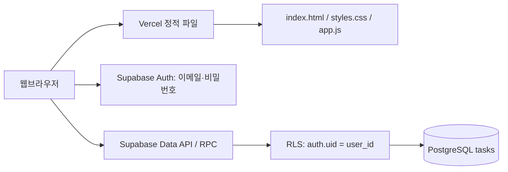

# 모아 칸반보드 아키텍처

## 1. 목표와 변경 범위
기존 `kanban.html`의 디자인, 3개 상태 칼럼, 검색, 우선순위 필터, 통계, 카드 편집, 드래그 이동, JSON 백업 기능을 유지한다. HTML·CSS·JavaScript를 분리하고 카드의 영구 저장소를 브라우저 localStorage에서 Supabase PostgreSQL로 변경한다.

기본 운영 모델은 **로그인 사용자별 개인 보드**다. 여러 사람이 같은 보드를 함께 수정하는 팀 보드가 아니다. 동일 계정으로 로그인하면 다른 기기에서도 저장한 카드를 조회할 수 있다.

## 2. 구성도

## 3. 파일별 책임
| 파일 | 책임 |
|---|---|
| `index.html` | 기존 보드와 모달, 로그인 폼의 구조 |
| `styles.css` | 원본 스타일과 반응형 레이아웃, 로그인 패널 |
| `app.js` | UI 렌더링, 입력 검증, 검색·필터, 드래그, 저장 호출, 백업 |
| `supabase.js` | Supabase 연결, 인증, CRUD, 페이지별 조회, 백업 교체 RPC |
| `config.js` | 공개 프로젝트 URL과 공개 클라이언트 키 |
| `schema.sql` | 테이블, 제약 조건, 인덱스, RLS, 백업 교체 함수 |
| `vercel.json` | 정적 배포 및 기본 응답 헤더 |
| `README.md` | 설정, 배포, 테스트 방법 |

## 4. 저장 및 조회 흐름
1. 이메일·비밀번호로 로그인하고 액세스 토큰을 메모리에서 관리한다.
2. 카드 목록을 Supabase에서 500개 단위로 조회한다.
3. 생성은 INSERT, 편집·상태 이동은 해당 ID에 대한 UPDATE, 삭제는 DELETE를 요청한다.
4. 서버 응답을 받은 뒤 다시 목록을 조회하여 화면을 갱신한다. 네트워크 오류가 발생하면 성공으로 표시하지 않는다. 쓰기 성공 후 재조회만 실패할 수도 있으므로 새로고침으로 서버 상태를 확인하도록 안내한다.
5. 검색·필터·통계는 메모리 목록에서 계산한다.
6. 다른 탭·기기의 변경은 창 포커스 복귀, 30초 주기 또는 새로고침 버튼으로 가져온다. **Realtime 구독 방식은 아니다.**

카드 데이터는 localStorage·sessionStorage·IndexedDB에 저장하지 않는다. 화면 표시를 위한 메모리 배열만 사용한다. 인증도 `persistSession:false`이므로 새로고침·탭 재접속 시 다시 로그인해야 한다. 로그인 상태가 유지되는 동안 토큰은 자동 갱신한다. 브라우저 자체 비밀번호 저장 기능은 앱 저장 정책과 별개다.

## 5. 데이터 모델
`tasks`: `id(uuid)`, `user_id(uuid)`, `title(text, 1~150자)`, `description(text, 최대 5000자)`, `status(todo/doing/done)`, `priority(low/medium/high)`, `due(date, nullable)`, `created_at`, `updated_at`.

ID와 소유자는 생성 시 서버 UUID 및 현재 사용자로 정한다. 저장 가능한 값은 DB CHECK/NOT NULL 제약으로도 검사한다. 사용자 삭제 시 그 사용자의 카드도 삭제된다.

## 6. 보안 경계
- 브라우저의 키는 공개용 publishable key 또는 legacy anon key만 사용한다. `service_role`, secret key는 클라이언트·저장소에 넣지 않는다.
- 보안의 근거는 키 은닉이 아니라 Auth + RLS다. 비로그인 역할에는 테이블 접근 권한을 부여하지 않는다.
- SELECT/INSERT/UPDATE/DELETE 모두 `auth.uid() = user_id`를 적용한다.
- 백업 복원 함수는 `SECURITY INVOKER`로 호출자의 권한과 RLS를 유지한다.
- 사용자 문자열은 `textContent`로 출력하여 HTML 삽입을 피한다.
- 공개 회원가입 시 누구나 자기 보드를 만들 수 있다. 제한 운영 시 Supabase에서 신규 가입 허용 정책을 별도로 설정한다.

## 7. 백업 및 기존 데이터 이전
내보내기는 현재 서버에서 조회한 목록의 JSON 파일을 사용자가 내려받는 기능이다. 다운로드 자체는 사용자의 명시적인 로컬 백업이며, 자동 저장과 다르다.

불러오기는 확인 후 **본인 카드만 전체 교체**한다. 단일 RPC 트랜잭션으로 삭제·삽입하여 실패하면 모두 롤백한다. 복원 시 ID·생성일은 새로 발급된다. 다른 사용자 데이터는 건드리지 않는다. 기존 원본의 JSON 백업도 지원한다. 기존 localStorage의 카드를 자동 수집하거나 업로드하지 않는다.

## 8. 배포와 의존성
Vercel은 정적 파일만 제공하고, 별도 API 서버·빌드 작업은 없다. 브라우저는 고정 버전 Supabase JavaScript SDK를 esm.sh에서 가져온다. CDN 접근이 불가능한 환경에서는 SDK 자체 호스팅 또는 번들링으로 바꿔야 한다. 현재 버전은 단순 정적 배포를 우선한 구성이다.

`config.js`는 공개 설정 파일이다. Vercel 환경변수는 순수 정적 JavaScript 파일에 자동 주입되지 않으므로 이 구성에서는 파일 값을 직접 설정한다. 비밀 환경변수를 공개 파일에 옮기지 않는다.

## 9. 제한과 확장 지점
- 오프라인 저장·수정 큐는 없다. 서버 연결이 필요하다.
- 동시 편집 충돌은 같은 필드에 대해 마지막 서버 쓰기가 반영된다. 버전 기반 충돌 감지·이력·휴지통은 미구현이다.
- 백업 복원 중 다른 기기에서 쓰지 않는 것을 권장한다. 복원끼리는 잠금으로 직렬화하지만 일반 CRUD까지 잠그지 않는다.
- 매우 큰 보드는 검색·통계도 서버 처리로 이전하는 것이 적합하다. 페이지 조회 전체가 단일 DB 스냅샷은 아니다.
- 팀 공유는 boards / board_members와 멤버십 RLS가 추가로 필요하다.

## 10. 검증 범위
원본 UI 분리, 로컬 저장 코드 제거, JavaScript 문법, HTML 참조 파일과 필수 ID 존재를 정적 검사했다. 실제 프로젝트 URL·키·로그인 계정이 제공되지 않아 Supabase SQL 실행, 실제 CRUD, 브라우저 상호작용, Vercel 배포는 실행하지 않았다. `README.md`의 배포 후 테스트로 확인한다.
